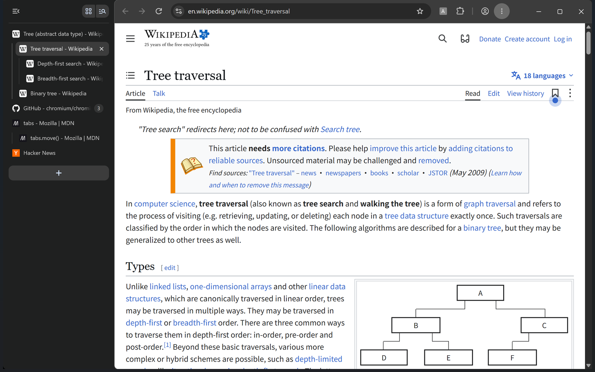
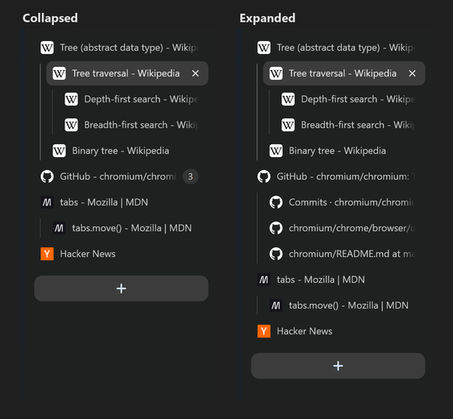
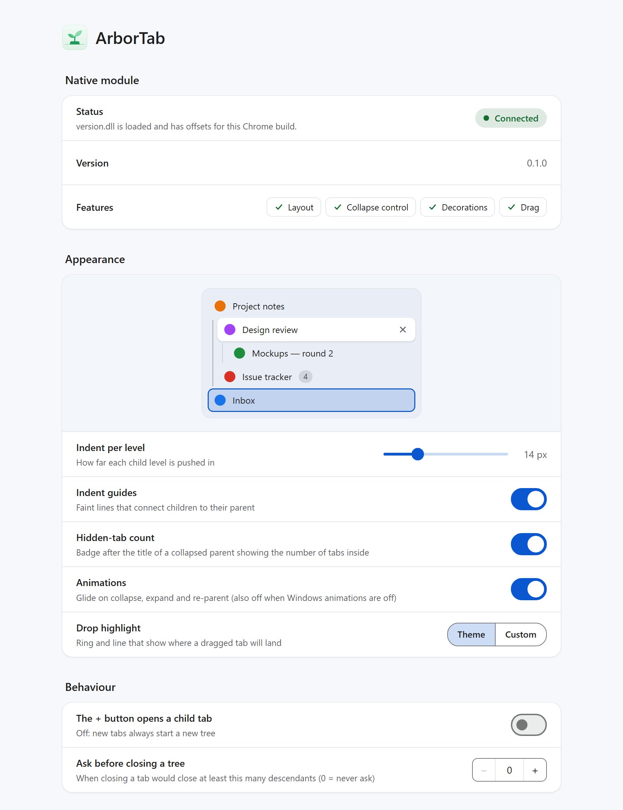
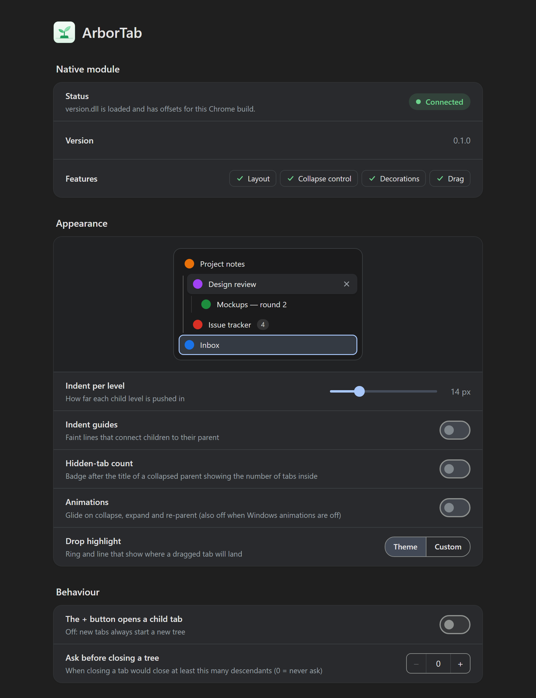

<div align="center">


# ArborTab

**Tree-style tabs inside Chrome's native vertical tab strip.**

Collapsible subtrees, close-with-children and drag-to-nest — without a sidebar, without a second tab list.




</div>

---

## ✨ Features

- 🌲 **Real tree structure.** Tabs opened from a link become children of the tab that opened them, and the strip shows them indented under their parent.
- 📂 **Collapse and expand.** Click a parent's favicon to fold its subtree away. A badge after the title shows how many tabs are hidden.
- 🧲 **Drag to nest.** Drop a tab onto the middle of another tab to make it a child, or onto an edge to place it beside it. A highlight shows where the tab will land before you let go.
- 🗑️ **Close a whole branch.** Closing a parent closes its subtree. You can have ArborTab ask first when a branch is large.
- 📏 **Indent guides.** Faint lines link children to their parent, and the active branch is drawn a little stronger.
- 🎞️ **Smooth motion.** Collapsing, expanding and re-parenting glide into place. Animations turn off when Windows animations are off.
- 🎨 **Fits your theme.** Colours come from Chrome's own theme, in light and dark mode. The drop highlight can use a custom colour.
- 🌍 **Localized** into English, German, Spanish, French, Japanese, Korean, and Simplified and Traditional Chinese.

## 📸 Screenshots

<table>
  <tr>
    <td align="center" width="42%"><br /><sub>Collapse a branch: the badge counts the hidden tabs</sub></td>
    <td align="center"><br /><sub>Settings with a live preview of the strip</sub></td>
  </tr>
</table>

<details>
<summary>🌙 Settings in dark mode</summary>
<br />

</details>

## 📥 Download

Everything is on the [latest release](https://github.com/EvATive7/chrome-plugin-arbortab/releases/latest) page:

| Component | File |
| --- | --- |
| 🧩 Extension | `arbortab-extension-<version>.zip` (the Chrome Web Store listing is planned) |
| ⚙️ Native module and bridge | `arbortab-native-<version>-win64.zip`, or the one-line command below |
| 🔐 Checksums | `SHA256SUMS` |

## 🚀 Installation

1. Turn on Chrome's vertical tab strip.
2. Install the **ArborTab extension**: unzip `arbortab-extension-<version>.zip` to a folder you keep, open `chrome://extensions`, turn on **Developer mode** and choose **Load unpacked** with that folder. The extension's settings page shows the next step.
3. Install the **native module**: press <kbd>Win</kbd>+<kbd>R</kbd> (or open a terminal), paste this command and press Enter. Quit Chrome when the installer asks.

   ```
   powershell -NoExit -NoProfile -ExecutionPolicy Bypass -Command "irm https://github.com/EvATive7/chrome-plugin-arbortab/releases/latest/download/install.ps1 | iex"
   ```

   The script comes from this repository's latest release. It downloads the matching native package, finds your Chrome, installs the small connector (`arbortab-bridge.exe`) for your user account, asks for administrator rights only if Chrome is installed for all users, and copies `version.dll` next to `chrome.exe`. Please read the security trade-off below first.
4. Start Chrome. On the extension's settings page, **Native module** should show **Connected**.

Prefer not to pipe a script into PowerShell? Download `arbortab-native-*-win64.zip` from the release, check it, and double-click `install.cmd` inside.

To remove the module, use the same command with `uninstall.ps1` instead of `install.ps1`, or run `uninstall.cmd` from the package (add `-Purge` to also delete logs and cached data).

> [!TIP]
> Right after a Chrome update, the settings page may show **Waiting for support** for a day or two: the offsets for the new build are generated automatically once Google publishes its symbols, and the module picks them up without reinstalling.

> [!NOTE]
> The extension keeps the tree on its own. The native module is what draws it in the strip: indentation, hiding, badges and drop highlights. Without the module, tabs stay flat and unchanged.

## ⌨️ Keyboard shortcuts

| Shortcut | Action |
| --- | --- |
| <kbd>Alt</kbd> + <kbd>Shift</kbd> + <kbd>,</kbd> | Collapse or expand the current tab's subtree |
| <kbd>Alt</kbd> + <kbd>Shift</kbd> + <kbd>W</kbd> | Close the current tab and its whole subtree |
| <kbd>Alt</kbd> + <kbd>Shift</kbd> + <kbd>↑</kbd> | Promote the current tab one level |
| <kbd>Alt</kbd> + <kbd>Shift</kbd> + <kbd>↓</kbd> | Nest the current tab under the previous sibling |

You can change them at `chrome://extensions/shortcuts`.

## 🔧 How it works

ArborTab has two parts:

| Part | Role |
| --- | --- |
| **Extension** (`extension/`) | Owns the tree. It tracks parents and collapsed state, performs every move through `chrome.tabs`, and keeps the real tab order equal to the tree's pre-order walk. |
| **Native module** (`native/`) | A `version.dll` proxy that Chrome loads at startup. It hooks the vertical tab strip's layout, painting and drag handling to show the tree. |

They talk through Chrome's [Native Messaging](https://developer.chrome.com/docs/extensions/develop/concepts/native-messaging): Chrome starts `arbortab-bridge.exe` for the extension, and the bridge connects to a named pipe that the module opens inside the same browser process. Each Chrome window set therefore talks to its own module, no network port is involved, and only processes started by that browser can connect.

The native module needs the internal function addresses and field offsets of each Chrome build. A [GitHub Actions workflow](.github/workflows/offsets.yml) checks for new stable releases every 6 hours. For each new release it pulls Chrome's public debug symbols, generates the offsets with [`resolver/`](resolver/), signs them, and publishes them to the `offsets` branch. The module downloads the matching table at runtime and refuses anything without a valid signature; a published table can also be revoked. Until a build's offsets are available, the module stays inactive and leaves Chrome untouched.

If Chrome exits abnormally twice in a row with the module active, the module switches itself off for that Chrome build and the settings page offers to turn it back on. The settings page can also export a debug report (versions, connection state and recent events, without URLs or titles) to attach to bug reports.

> [!IMPORTANT]
> **Security trade-off.** Chrome only lets Microsoft-signed DLLs load into its renderer and GPU processes. For an unsigned `version.dll` to work, the module turns off that one mitigation for the child processes Chrome starts, which lowers their code-integrity protection. Please weigh this before installing.

## 🛠️ Building from source

Requirements: Windows x64, Visual Studio 2022 Build Tools (MSVC), CMake + Ninja, [uv](https://github.com/astral-sh/uv) and Node.js.

```sh
# Build the native module and the bridge → artifacts/native/
pwsh -File tools/dev/build-native.ps1

# Unit tests (tree model, protocol checks)
node --test extension/test/*.test.mjs
```

Load `extension/` as an unpacked extension from `chrome://extensions` with Developer mode on.

For the sandboxed dev loop, end-to-end tests and the debugging notes, see [AGENTS.md](AGENTS.md).

## 📄 License

[GPL-3.0-only](LICENSE)
